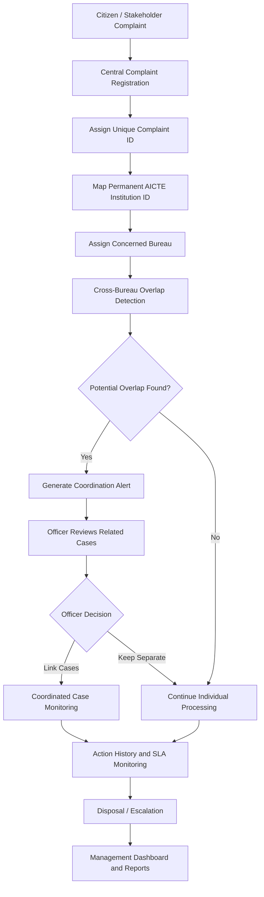

# AICTE NIVARAN
### National Integrated Voice for Action, Redress & Accountability

**An Integrated Institution Complaint Monitoring, 360° Audit & Cross-Bureau Overlap Coordination Platform**

<p align="center">
  
  
  
  
  
</p>

---

## 🌐 Live Demo

| Resource | Link |
|---|---|
| **Public Web Application** | [AICTE NIVARAN](https://aicte-nivaran-phi.vercel.app) |
| **Interactive API Documentation** | [FastAPI Swagger](https://aicte-nivaran-api.onrender.com/docs) |
| **Demo Account** | `officer.aicte@nic.in` |
| **Operational Role** | Super Admin |

*Demo password is shared separately and is intentionally not published in this repository.*

---

## 📌 Problem Statement

The **All India Council for Technical Education (AICTE)** receives complaints and grievances from students, faculty members, institutions and other stakeholders.

These complaints are processed by multiple Bureaus and Cells, including:

- **Regulation Bureau (RB):** Faculty service rules, pay scale violations and unapproved courses.
- **Public Grievance Redressal Cell (PGRC):** Student grievances, certificate retention and curriculum disruptions.
- **Approval Bureau (AB):** Infrastructure norms and Extension of Approval (EoA) compliance.
- **Vigilance Cell (VIG):** Financial irregularities and administrative misconduct.
- **Regional Offices:** Institutional verification and field-level monitoring.

### The problem: Departmental silos

A single institutional issue can generate multiple complaints across different Bureaus.

For example:
- Faculty members report salary non-payment to the Regulation Bureau.
- Students report suspended classes to the Public Grievance Redressal Cell.

Without centralized monitoring, this can result in:

1. **Duplicated administrative effort:** Multiple officers investigate the same institution independently.
2. **Conflicting actions:** Different Bureaus may initiate parallel proceedings.
3. **Delayed disposal:** Lack of coordination increases resolution time.
4. **Limited visibility:** Officials cannot easily identify all ongoing cases against an institution.

---

## 💡 Our Solution: AICTE NIVARAN

AICTE NIVARAN establishes a centralized platform for monitoring institution-related complaints and coordinating actions across Bureaus.

### Three core pillars

| Pillar | Function |
|---|---|
| **Institution 360° Profile** | A consolidated institutional record containing complaints, regulatory actions and case history. |
| **Intelligent Overlap Detection** | Identifies potentially related complaints across different Bureaus using text similarity and institutional mapping. |
| **Coordinated Case Disposal** | Enables officers to review, link and coordinate related cases while maintaining an audit trail. |

### Core innovation

The system identifies potential overlaps even when complaints have different descriptions or originate from different departments.

Example:

**Institution A**
- RB: Complaint regarding faculty termination.
- PGRC: Complaint regarding disruption of classes due to faculty removal.

NIVARAN identifies the common institution and flags:

`POTENTIAL OVERLAPPING CASES — COORDINATION REQUIRED`

The system provides similarity indicators and supporting information. Authorized officers review and decide whether the cases should be linked.

---

## 🏛️ Key Features

### 1. Centralized Institution Profile

- Unique Permanent AICTE ID mapping.
- Institution name, address, state and region.
- Consolidated complaint history.
- Active, pending and disposed case records.
- Institution-wise regulatory activity overview.

### 2. Cross-Bureau Overlap Detection

**The core innovation of NIVARAN.**

- Detects multiple complaints concerning the same institution.
- Uses RapidFuzz-based text similarity matching.
- Identifies potentially related complaints despite differences in wording.
- Displays similarity scores and detection categories.
- Provides a coordination recommendation.
- Supports officer-reviewed case linking.

### 3. Complaint and Case Tracking

- Unique complaint identification.
- Complaint category and date of receipt.
- Assigned Bureau and responsible officer.
- Current case status and priority.
- Expected disposal date and SLA monitoring.
- Complete chronological action history.

### 4. Dashboard and Analytics

- Total complaints received.
- Pending and under-process cases.
- Disposed and overdue cases.
- Bureau-wise workload.
- Institution-wise complaint history.
- Regional complaint distribution.
- Complaint ageing and disposal analysis.

### 5. Workflow and Audit Trail

- Timestamped case history.
- Officer-wise action records.
- Bureau transfer and escalation tracking.
- Supporting remarks and action documentation.
- Related-case coordination history.

### 6. Reports and Notifications

- Pending case reminders.
- Potential overlap notifications.
- SLA and overdue alerts.
- Bureau-wise and region-wise analytics.
- CSV-compatible reporting.

### 7. Accessibility and Usability

- English and Hindi interface support.
- Font scaling controls.
- High-contrast display mode.
- Slide-over case details.
- Searchable and filterable complaint records.

---

## 🏗️ System Architecture

```text
                 AUTHORIZED AICTE OFFICIALS
                            |
                            v
                +-----------------------+
                |   React Frontend      |
                |   Tailwind CSS        |
                |   Dashboard & Reports |
                +-----------------------+
                            |
                            v
                +-----------------------+
                |     FastAPI Backend   |
                |      REST API         |
                +-----------------------+
                            |
             +--------------+--------------+
             |              |              |
             v              v              v
       +-----------+  +------------+  +-------------+
       | Institution|  | Complaint  |  | Overlap     |
       | Management |  | Management |  | Detection   |
       +-----------+  +------------+  +-------------+
             |              |              |
             +--------------+--------------+
                            |
                            v
                +-----------------------+
                |   SQLAlchemy ORM      |
                +-----------------------+
                            |
                            v
                +-----------------------+
                | SQLite / PostgreSQL   |
                +-----------------------+
```

### Technology Stack

| Layer | Technology | Purpose |
|---|---|---|
| Frontend | React 18, Vite | Interactive single-page application |
| Styling | Tailwind CSS | Responsive interface and design system |
| Charts | Recharts | Dashboard analytics |
| Mapping | Leaflet | Interactive geographical visualization |
| State Management | React Context | Shared application state |
| Routing | React Router | Navigation and protected routes |
| Backend | Python FastAPI | REST API services |
| Validation | Pydantic v2 | Request and response validation |
| ORM | SQLAlchemy 2.0 | Database operations |
| Database | SQLite / PostgreSQL | Relational data storage |
| Overlap Detection | RapidFuzz | Text similarity matching |
| Deployment | Vercel / Render | Frontend and backend hosting |

---

## 🔄 End-to-End Workflow



---

## 🚀 Installation and Local Setup

### Prerequisites

- Node.js 18 or higher
- Python 3.11 or higher
- Git

### 1. Clone the Repository

```bash
git clone https://github.com/darkpegassus/aicte-nivaran.git

cd aicte-nivaran
```

### 2. Backend Setup

```bash
cd backend

# Create virtual environment
python -m venv venv

# Activate virtual environment (Windows)
venv\Scripts\activate

# macOS / Linux
source venv/bin/activate

# Install dependencies
pip install -r requirements.txt

# Populate synthetic demonstration data
python seed_data.py

# Start FastAPI server
uvicorn app.main:app --reload --port 8000
```

Backend API:

- API Root: http://127.0.0.1:8000
- Interactive API Documentation: http://127.0.0.1:8000/docs

### 3. Frontend Setup

Open a separate terminal at the project root (the directory containing `package.json`).

```bash
# Install dependencies
npm install

# Start Vite development server
npm run dev
```

Open the local URL printed by Vite in your terminal.

---

## 🧪 Demonstration Scenario: Cross-Bureau Overlap Detection

The following scenario demonstrates NIVARAN's core functionality.

### Step 1: Access the Dashboard

Sign in using the authorized demonstration account.

### Step 2: Review Existing Complaint

Navigate to the institution:

**Apex Institute of Technology & Management**

Permanent AICTE ID: `AICTE-1-4328911`

An existing Regulation Bureau complaint is available:

- Case ID: `CMP-2025-0101`
- Bureau: Regulation Bureau (RB)
- Issue: Illegal termination of faculty members.

### Step 3: Register a Related Complaint

Navigate to **Complaints → Register New Complaint**.

Enter the following demonstration details:

| Field | Value |
|---|---|
| Institution | Apex Institute of Technology & Management |
| Bureau | Public Grievance Redressal Cell |
| Category | Student Grievance & Harassment |
| Subject | Final-year class disruption due to faculty removal |
| Description | CSE students report complete stoppage of classes following abrupt dismissal of core department professors. |

Submit the complaint.

### Step 4: Inspect Overlap Detection

Navigate to the **Overlap Detection Engine**.

The system identifies the common institution and evaluates the similarity between the two complaints.

Review:
- Similarity score.
- Detection category.
- Bureau assignments.
- Case descriptions.
- Coordination recommendation.

### Step 5: Coordinate Cases

Use the case comparison interface to inspect both complaints.

An authorized officer can choose to link the cases for coordinated monitoring.

### Step 6: Verify Dashboard Updates

Return to the dashboard to inspect updated complaint statistics and overlap information.

---

## 🔐 Security, Compliance and Data Disclaimer

- **Synthetic Data:** All institution names, identification records, officer details and complaint descriptions included in the demonstration dataset are synthetic.
- **No Production Access:** This application is not connected to live AICTE networks or confidential government databases.
- **Advisory Decision Support:** Overlap detection generates potential matches, not legal conclusions.
- **Human-in-the-Loop:** Authorized officers must review and approve case-linking decisions.
- **Authentication:** Demonstration authentication must not be treated as production-grade government identity verification.
- **Data Protection:** Real institutional, personal or confidential complaint records should not be uploaded to this demonstration deployment.

---

## 👥 Hackathon Context and Acknowledgements

| Detail | Information |
|---|---|
| Initiative | Smart India Hackathon 2026 |
| Nodal Organization | All India Council for Technical Education (AICTE) |
| Ministry | Ministry of Education, Government of India |
| Project | AICTE NIVARAN |
| Domain | Institutional Complaint Monitoring and Regulatory Coordination |

---

## 📄 License

This project is intended to be open-source under the **MIT License**.

See the `LICENSE` file for details.

---

<p align="center">
  <b>AICTE NIVARAN</b><br/>
  One Institution. One Consolidated View. Better Coordination.
</p>
